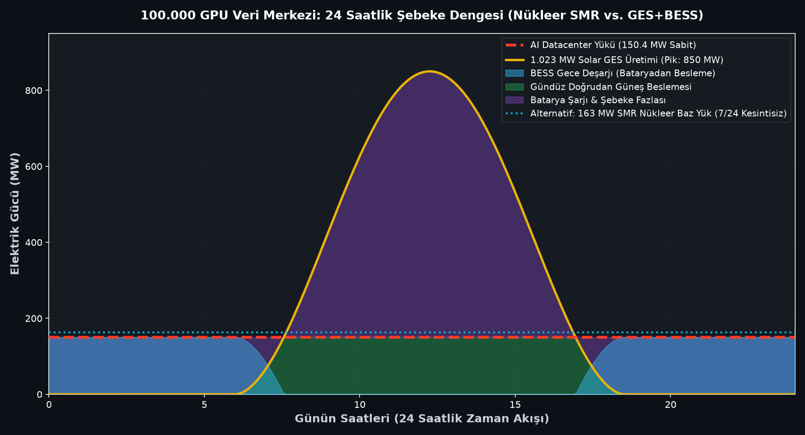
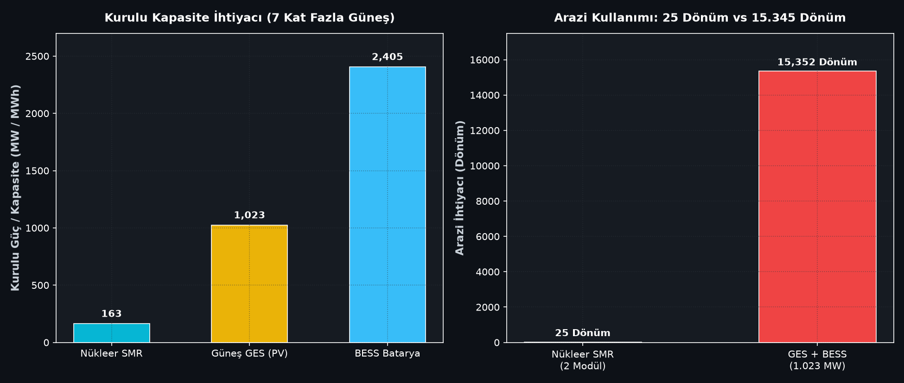

# ⚡ 100k GPU Hyperscale AI Datacenter & Nuclear SMR Dispatch Model
> **Case Study:** 100,000 GPU AI Cluster (150 MW 24/7/365 Continuous Baseload) — Small Modular Reactor (SMR) vs. 100% Renewable Solar+BESS Overbuild

[](https://www.python.org/downloads/)
[](https://opensource.org/licenses/MIT)
[]()

---

## 📌 Executive Summary
With the rapid scaling of LLM training and real-time inference clusters, **hyperscale AI data centers** have transformed from standard commercial electricity consumers into industrial mega-loads requiring non-interruptible, ultra-reliable **24/7/365 baseload power**.

This repository provides an open-source, engineering-first techno-economic and power dispatch model analyzing why technology giants (**Microsoft, Google, Amazon**) are signing long-term Power Purchase Agreements (PPAs) with nuclear power plants and **Small Modular Reactor (SMR)** developers.

### ❓ The Engineering Dilemma
A state-of-the-art **100,000 GPU cluster** (NVIDIA H100 SXM5 / B200 class) draws:
- **Net IT Compute Load:** ~127.5 MW
- **PUE (Direct Liquid Cooling):** 1.18
- **Total Continuous Grid Power Demand:** **150.5 MW (Flat Baseload, zero tolerance for outages)**

To supply this 150.5 MW demand purely with intermittent renewables (Solar PV + Battery Energy Storage):
- Solar capacity must be **overbuilt by ~6.8x to 1,023 MWp (1.02 GW)** to compensate for diurnal non-generation.
- Battery energy storage must provide **2,407 MWh (2.41 GWh)** to sustain 14-16 hours of night discharge.
- Land footprint escalates to **~15,350 dönüm (~15.3 km²)**.

In contrast, a **163 MW Gen-IV SMR plant (2x ~81 MW modules)** delivers continuous 24/7 baseload on just **25 dönüm (2.5 hectares)** with zero carbon emissions and passive thermosiphon safety.

---

## 📊 Scientific Data & Benchmark Citations

| Parameter / Claim | Modeled Value | Authoritative Source / Real-World Benchmark |
| :--- | :--- | :--- |
| **GPU Server Power Density** | 1020 W / Tray (+25% InfiniBand/Optics) | NVIDIA H100 / HGX Specifications & OCP Open Rack v3 |
| **Facility PUE** | **1.18** (Direct-to-Chip Liquid Cooling) | Google Cloud / Meta Hyperscale Efficiency Benchmark (2024) |
| **Grid Power Demand** | **150.45 MW (~150.5 MW continuous)** | Electric Power Research Institute (EPRI) AI Power Forecast |
| **SMR Capacity & Factor** | **162.6 MW @ 92.5% CF** (1.318M MWh/yr) | U.S. DOE Nuclear Energy Office / NuScale & Rolls-Royce iPWR Data |
| **Real-World PPA Baseline** | Susquehanna (960 MW) & Three Mile Island (835 MW) | AWS / Talen Energy PPA ($650M) & Microsoft / Constellation Energy PPA |
| **Renewable Overbuild Ratio** | **~6.8x Solar (1,023 MW) + 2,407 MWh BESS** | National Renewable Energy Laboratory (NREL) SAM Simulation |
| **Land Footprint Ratio** | **15,350 Dönüm (Solar) vs. 25 Dönüm (SMR)** | NREL Land-Use Requirements for Utility-Scale Energy Systems |

---

## 📈 Visualizations & Results

### 1. 24-Hour Grid Baseload Dispatch Profile
Comparison of flat 150.5 MW AI data center demand against 1,023 MW Solar PV generation and 2,407 MWh BESS charge/discharge cycles:



### 2. Installed Capacity Overbuild & Land Footprint
The physical land area and installed nameplate capacity required to reliably serve a 150.5 MW continuous load:



---

## 🔬 Mathematical Formulations

### 1. Hyperscale AI Total Grid Demand
$$P_{\text{grid}} = \left[ N_{\text{GPU}} \times P_{\text{tray}} \times (1 + \alpha_{\text{net}}) \right] \times \text{PUE}$$

Where:
- $N_{\text{GPU}} = 100,000$ accelerators
- $P_{\text{tray}} = 1,020\text{ W}$ (accelerator + memory + voltage regulator)
- $\alpha_{\text{net}} = 0.25$ (networking fabric, optics, and spine switches)
- $\text{PUE} = 1.18$ (cooling pumps, cooling towers, power distribution unit losses)
- **Result:** $P_{\text{grid}} = 150.45\text{ MW}$

### 2. SMR Passive Thermosiphon Circulation (Natural Convection)
In Station Blackout (SBO) emergencies, Gen-IV SMRs utilize gravity and natural convection without active electrical pumps ($0\text{ kW}$ pump power):

$$\Delta P_{\text{buoyancy}} = \oint \rho(T) g dz = \rho_0 g \beta (T_{\text{hot}} - T_{\text{cold}}) \Delta H_{\text{thermal}}$$

The volumetric natural flow rate $Q_{\text{natural}}$ scales with the thermal elevation head $\Delta H$:

$$Q_{\text{natural}} \propto \left( \frac{g \beta \dot{Q}_{\text{decay}} \Delta H}{\rho_0 c_p R_{\text{hydraulic}}} \right)^{1/3}$$

This ensures continuous, passive core decay heat removal indefinitely with zero external electricity.

### 3. Solar Overbuild & BESS Sizing
$$C_{\text{PV}} = \frac{P_{\text{grid}}}{\text{CF}_{\text{solar}}} = \frac{150.45\text{ MW}}{0.147} \approx 1,023.5\text{ MWp}$$

$$E_{\text{BESS}} = \frac{P_{\text{grid}} \times t_{\text{discharge}}}{\eta_{\text{RTE}}} = \frac{150.45\text{ MW} \times 13.83\text{ h}}{0.865} \approx 2,405.5\text{ MWh}$$

---

## 🚀 Quickstart & Installation

```bash
# 1. Clone repository
git clone https://github.com/talhacrak01/ai-datacenter-nuclear-sim.git
cd ai-datacenter-nuclear-sim

# 2. Install dependencies
pip install -r requirements.txt

# 3. Run techno-economic simulation & generate plots
python simulate.py
```

---

## 👨‍💻 Author
**Talha Çırak**  
*Energy Systems Engineering Student & Researcher*  
- Focus: Hyperscale AI Power Infrastructure, Nuclear SMRs, Grid-Scale Energy Storage, Power System Modeling.
- Instagram: [@talhacirak_energy](https://instagram.com/talhacirak_energy)
- Video: Devlog #02 — Yapay Zeka Veri Merkezleri ve Nükleer Enerji Rönesansı
